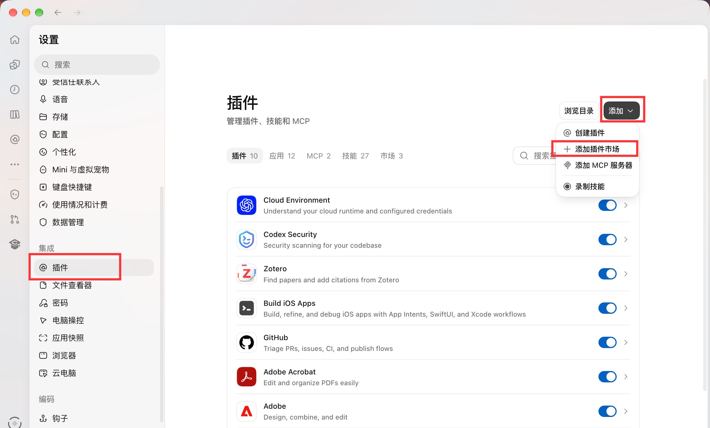
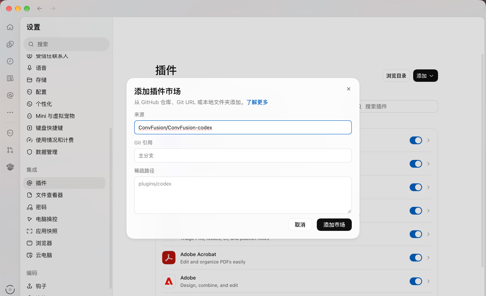
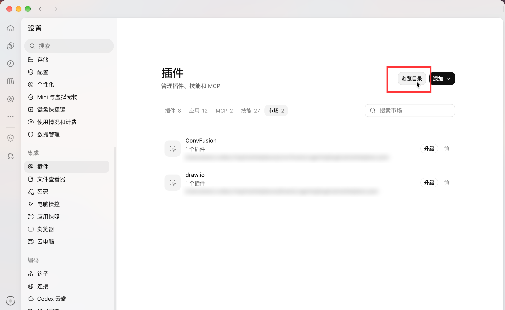
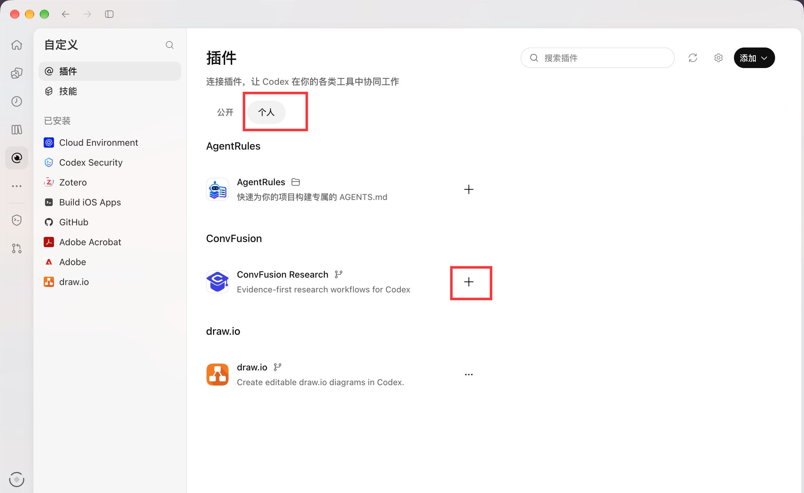
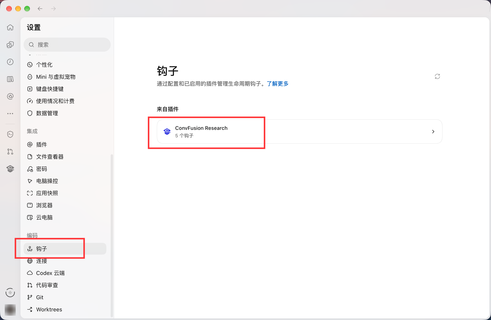
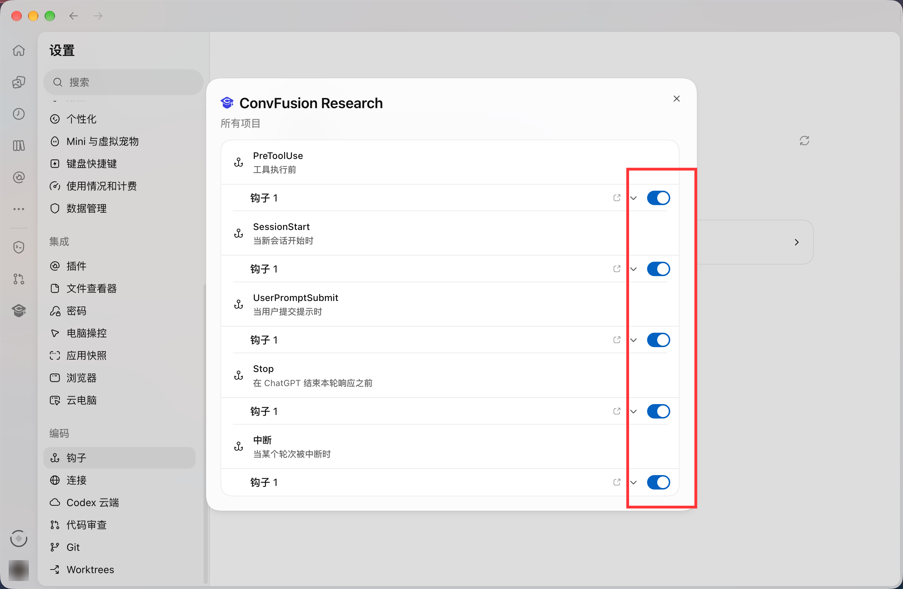
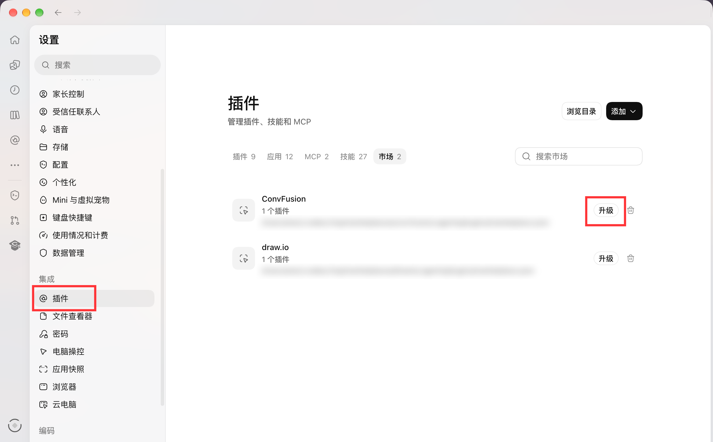

<p align="center">
  
</p>

<h1 align="center">ConvFusion for Codex</h1>

<p align="center"><strong>面向 Codex 的科研工作流插件</strong></p>

<p align="center">
  
  
  <a href="./LICENSE"></a>
</p>

---

ConvFusion 帮助研究者在 Codex 中完成文献整理、研究规划、实验设计、论文写作和成果输出，并将研究资料、实验结果及结论保存在本地，方便持续管理和追溯。

## 主要功能

- 文献检索、开放全文下载、筛选与综述
- 研究问题、假设、技术路线和实验方案设计
- 研究计划、证据、结论和决策记录管理
- 论文写作、修订、科研配图及 LaTeX 处理
- 专利、技术报告和演示文稿整理
- 研究进展查看、研究方法定制
- 研究上下文自动刷新、Plan 历史及有轮数上限的自动推进
- ConvFusion.com 研究发布、寻找线上导师或学生、研究资料交换与同步

## 系统要求

- 支持插件和本地 MCP 的 Codex Desktop 或 Codex CLI
- Node.js 20 或更高版本

## 安装

### Codex 桌面版

1. 打开 Codex 的**设置 → 插件**，点击右上角的**添加**，选择**添加插件市场**。

   
2. 在**来源**中输入本项目的 GitHub 仓库 `ConvFusion/ConvFusion-codex`，然后点击**添加市场**。

   
3. 添加完成后，在**市场**标签页确认列表中出现 **ConvFusion**，再点击右上角的**浏览目录**。

   
4. 切换到**个人**分类，在 **ConvFusion** 分组中找到 **ConvFusion Research**，点击右侧的 **＋** 按钮安装，并按界面提示完成后续操作。

   

### 命令行安装

```bash
codex plugin marketplace add ConvFusion/ConvFusion-codex --ref main
codex plugin add convfusion-codex@convfusion
```

### 安装后：启用钩子（Hooks）

安装后重新打开 Codex 或创建一个新任务，无需单独部署服务。

钩子让插件在会话开始、提交需求和调用工具前自动刷新研究上下文，并在每轮结束时记录研究进展、按设定的轮数上限衔接后续研究。安装插件后，还需要单独审核并信任这些钩子，才能使用自动上下文、回合进展和自动推进功能。

1. 打开**设置 → 钩子**，在**来自插件**中选择 **ConvFusion Research**。

   
2. 展开查看各项钩子的配置，按 Codex 提示完成信任审核，并打开需要使用的开关。蓝色开关表示已启用；使用完整的自动上下文、回合进展和自动推进功能时，请启用该插件的全部钩子。

   

自动推进仅适用于已授权的研究任务，受轮数上限控制，可在工作台的研究进展页关闭或调整。**未启用钩子时，仍可通过聊天和工作台使用研究工具。**

## 更新

### Codex 桌面版

打开**设置 → 插件 → 市场**，找到 **ConvFusion**，点击右侧的**升级**按钮，等待界面提示更新完成即可。



### 命令行更新

```bash
codex plugin marketplace upgrade convfusion
```

## 快速开始

在 Codex 任务中调用：

```text
$convfusion-research 帮我建立一个关于无人机视觉-LiDAR 跨模态定位的研究项目
```

也可以继续提出具体需求：

```text
整理这个方向的相关文献，比较现有方法，并列出值得研究的问题。
```

```text
评估当前研究还缺少哪些证据，并给出下一步实验计划。
```

新建研究项目后，资料保存在当前任务目录的 `workspace/` 中。

## 交互界面

在 Codex 的侧边栏或插件应用列表中打开 **ConvFusion 工作台**，即可登录账号、浏览研究网络和研究方法。

也可以在聊天中提出：

```text
打开 ConvFusion 界面，我要寻找线上导师。
```

界面包含研究网络、研究进展和研究方法，支持全局侧栏入口和聊天侧面板。从项目聊天中 @ 使用插件并打开工作台时，自动使用当前任务目录，可查看该项目的研究进展。也可以打开工具返回的本地链接使用界面。

使用研究网络时，在界面中配置服务器并登录 ConvFusion.com，再选择研究工作、上传文件和发布方向。涉及费用的操作会在界面中显示确认信息。

下载研究资料后，将界面提供的同步请求复制到 Codex。插件会先检查压缩包与本地研究的差异，确认后再同步。

聊天侧面板支持编辑同步请求后发送给 Codex。研究方法页支持导出方法与完整正文；研究进展页可以关闭自动推进或调整连续推进上限。

## 可选配置

文献检索可通过环境变量配置 OpenAlex API Key 和联系邮箱：

```bash
export OPENALEX_API_KEY="..."
export OPENALEX_MAILTO="you@example.com"
```

未配置 API Key 时，仍可使用本地研究资料管理功能。

## 许可证

本项目采用 [MIT License](LICENSE)。
